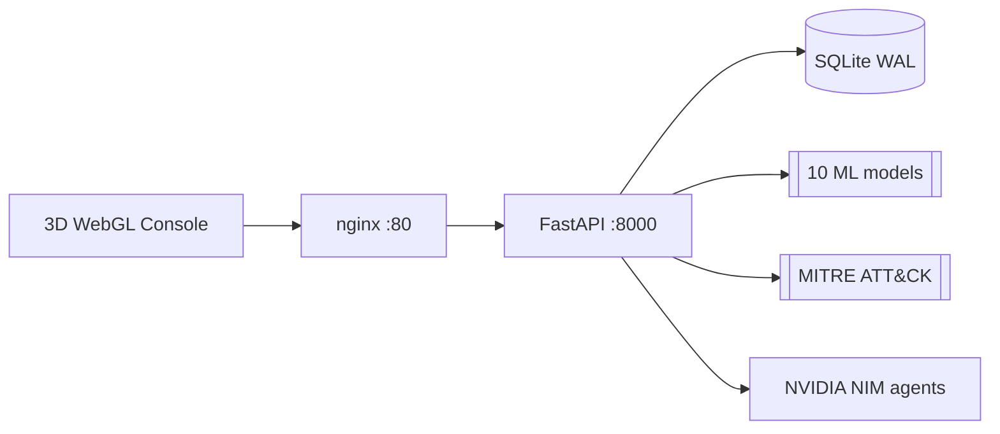

# Cerberus — Multi-Agent DevSecOps & Security Intelligence Platform

[](https://github.com/Aikagra-rgb/Cerberus/actions/workflows/ci.yml)
[](https://python.org)
[](https://fastapi.tiangolo.com)
[](https://threejs.org)
[](LICENSE)
[](CHANGELOG.md)

> **Cerberus** (**C**ognitive **E**ngine for **R**eal-time **B**ehavioral **E**valuation, **R**esponse & **U**nified **S**ecurity) is an agentic Security Operations (SOC) platform that fuses multi-model machine learning, MITRE ATT&CK RAG retrieval, active IPS gatekeeping, and an interactive 3D WebGL command console.

**1.0.0** is the first stable release: a documented API-stability contract, a security policy, production deployment guidance, and an 87%-covered test suite. See [CHANGELOG.md](CHANGELOG.md).

---

## Key Features

- **Multi-Agent DevSecOps Pipeline** — four LLM agents (Triage → Research → Remediation → Guardrail) analyze threats, retrieve MITRE context, draft remediation, and safety-gate the plan before output.
- **Layered Detection** — deterministic signature matching, ten Random Forest classifiers over a unified 20-feature vector, and cumulative-IP-reputation IPS gatekeeping.
- **MITRE ATT&CK Knowledge Base** — RAG semantic search across 700+ enterprise techniques.
- **Real-Time Active IPS** — automatic blocklisting at a reputation threshold, with optional host firewall enforcement (iptables / Windows Defender).
- **3D WebGL Security Console** — a Three.js console with live threat telemetry over WebSocket.
- **Production Observability** — structured JSON logs with request correlation, Prometheus metrics, and liveness/readiness/health probes.

---

## Architecture



Full details — detection pipeline, agent sequence, storage, and observability — are in
**[docs/ARCHITECTURE.md](docs/ARCHITECTURE.md)**.

---

## Quick Start

### Docker Compose (recommended)

```bash
git clone https://github.com/Aikagra-rgb/Cerberus.git
cd Cerberus

cp .env.example .env       # set ADMIN_USERNAME + ADMIN_PASSWORD (and API keys)
docker compose up -d --build

curl -f http://localhost/health
```

Open **http://localhost** and log in with your admin credentials.

### Local processes

```bash
pip install -r requirements.txt
cp .env.example .env       # set ADMIN_USERNAME + ADMIN_PASSWORD

# Terminal 1 — backend API
python -m uvicorn api:app --host 0.0.0.0 --port 8000

# Terminal 2 — 3D console
python serve_frontend.py   # or: cd frontend && node server.mjs
```

> The API refuses to start until `ADMIN_USERNAME` and `ADMIN_PASSWORD` are set —
> no default credentials are ever created, by design.

Configuration options are documented in [`.env.example`](.env.example) and
[docs/DEPLOYMENT.md](docs/DEPLOYMENT.md).

---

## API

Interactive docs are served at `/docs` (Swagger) and `/redoc`. A full reference,
with authentication and examples, lives in **[docs/API.md](docs/API.md)**.

```bash
# Log in and capture a session token
TOKEN=$(curl -s -X POST http://localhost:8000/api/auth/login \
  -H "Content-Type: application/json" \
  -d '{"username":"admin","password":"change-me"}' | jq -r .token)

# Ingest a log line and inspect generated alerts
curl -s -X POST http://localhost:8000/api/logs \
  -H "Authorization: Bearer $TOKEN" -H "Content-Type: application/json" \
  -d '{"line":"203.0.113.7 UNION SELECT 1","source":"demo"}'
```

The public API is **stable** as of 1.0.0 — see
[docs/API_STABILITY.md](docs/API_STABILITY.md) for the compatibility and deprecation policy.

---

## Tech Stack

- **Backend:** FastAPI, SQLite (WAL), Python 3.11+
- **AI & NLP:** NVIDIA NIM (DeepSeek + Nemotron agents), scikit-learn Random Forests, MITRE ATT&CK RAG
- **Frontend:** HTML5, CSS3, Three.js 3D WebGL
- **Ops:** Docker, Docker Compose, GitHub Actions, Prometheus

---

## Testing

```bash
pip install -r requirements-dev.txt
make test          # pytest + coverage gate (70%)
make lint          # ruff + mypy
make security      # bandit + pip-audit
```

The suite runs 100 tests with **87%** coverage across `src/` and `api.py`.

---

## Project Layout

```
api.py              FastAPI application
sentinel_engine.py  Host log monitoring daemon
trainer.py          ML model training (CIC-IDS2017)
src/                Detection service, storage, agents, settings
frontend/           3D WebGL console + nginx image
models/             Trained classifiers
docs/               Architecture, deployment, API, ADRs
tests/              pytest suite
```

---

## Deployment

Container, reverse-proxy/TLS, health-probe, scaling, and troubleshooting guidance is in
**[docs/DEPLOYMENT.md](docs/DEPLOYMENT.md)**. Tagged releases build and publish images to
GitHub Container Registry via [`.github/workflows/release.yml`](.github/workflows/release.yml).

---

## Security

Report vulnerabilities privately — see **[SECURITY.md](SECURITY.md)**. Cerberus uses
fail-closed startup, parameterized SQL, argument-list command execution (no shell),
strict input validation, RBAC, and non-root containers.

---

## Contributing

Contributions are welcome. Please read **[CONTRIBUTING.md](CONTRIBUTING.md)** and our
**[Code of Conduct](CODE_OF_CONDUCT.md)** first. Architecture decisions are tracked as
[ADRs](docs/adr/README.md).

---

## License

Distributed under the MIT License. See [LICENSE](LICENSE) for details.
