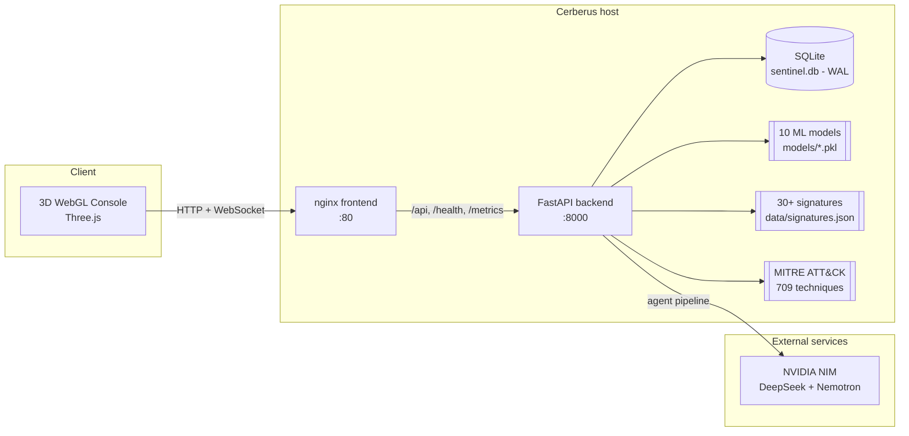
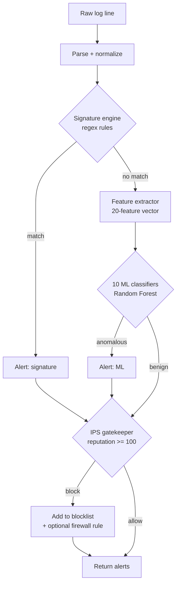
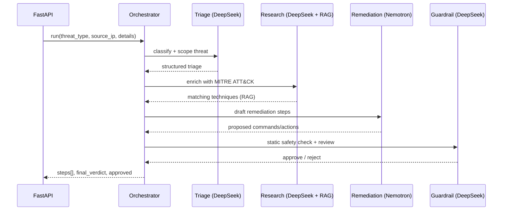

# Architecture

Cerberus (**C**ognitive **E**ngine for **R**eal-time **B**ehavioral **E**valuation,
**R**esponse & **U**nified **S**ecurity) is a single-host Security Operations
platform. It fuses signature matching, ten machine-learning classifiers, a MITRE
ATT&CK retrieval engine, and an autonomous multi-agent remediation pipeline behind a
FastAPI service with a 3D WebGL console.

This document describes the runtime components and how a log line flows through them.

## High-Level Topology



The frontend container proxies every `/api/*`, `/health`, and `/metrics` request to
the `backend` service (see `frontend/nginx.conf`). Only the frontend port needs to be
exposed in production.

## Detection Pipeline

A submitted log line is processed by `DetectionService` in three ordered stages. The
first stage that fires produces an alert; stages are complementary, not exclusive.



1. **Signature engine** — fast, deterministic regex rules loaded from
   `data/signatures.json` (SQLi, XSS, traversal, C2 beacons, and more).
2. **AI detection engine** — a unified 20-feature vector (`src/config.py`,
   `UNIFIED_FEATURES`) is extracted and scored by ten Random Forest pipelines:
   `web`, `auth`, `dos`, `recon`, `ddos`, `botnet`, `infiltration` classifiers plus
   isolation models. All models share the same feature set and use "not BENIGN"
   labelling.
3. **Active IPS gatekeeper** — cumulative per-IP reputation; at or above the
   configured threshold (default 100) the IP is blocklisted automatically and can be
   pushed to the host firewall.

Alerts are persisted to SQLite with an optional AI report; the schema and access
layer live in `src/alert_store.py`.

## Multi-Agent DevSecOps Pipeline

Triggered by `POST /api/triage/multi-agent`, the orchestrator runs four LLM agents in
sequence and returns a verified remediation plan.



The **Guardrail** agent is the safety gate: it performs static checks on the proposed
plan and can reject destructive output before it reaches an operator. Per-agent
latency and status are exported as Prometheus metrics.

## Storage

`src/alert_store.py` owns all persistence:

- **Engine:** SQLite in WAL mode ([ADR 0001](adr/0001-sqlite-wal-mode.md)) for
  concurrent reads alongside writes.
- **Tables:** alerts/evidence, blocked IPs, threat reputations, sessions, users.
- **Async:** a parallel `aiosqlite` access path supports async callers.
- **Migrations:** legacy CSV evidence is imported idempotently on startup via
  `migrate_legacy_csv`.

## Observability

| Signal | Mechanism |
| --- | --- |
| Structured logs | `structlog` JSON logs with request correlation via `X-Request-ID` |
| Metrics | `/metrics` (Prometheus): request counts/latency, active alerts, blocked IPs, pipeline latency/status |
| Liveness | `/live` |
| Readiness | `/ready` (checks DB + AI engine) |
| Health | `/health` (brains loaded, signature count) |

## Directory Layout

```
api.py                     FastAPI application (routes, middleware, auth)
sentinel_engine.py         Host log monitoring daemon
trainer.py                 Trains the ML classifiers on CIC-IDS2017 CSVs
serve_frontend.py          Static frontend server
src/
  config.py                Paths, unified feature set, model configs
  settings.py              Pydantic settings (env + .env)
  detection_service.py     Signature -> AI -> IPS pipeline
  feature_extractor.py     20-feature vector extraction
  alert_store.py           SQLite/WAL persistence + async API
  ai_triage.py             Triage helpers
  logging_config.py        structlog configuration
  agents/                  Orchestrator, 4 agents, LLM provider, RAG engine
frontend/                  React + Vite + TypeScript SOC SPA (Three.js 3D WebGL + Nginx)
models/                    Trained classifiers + metrics JSON
data/                      Signatures, MITRE dataset, sample logs
docs/                      Architecture, deployment, API, ADRs
tests/                     pytest suite
```

## Related Decisions

- [ADR 0001 — SQLite WAL mode](adr/0001-sqlite-wal-mode.md)
- [ADR 0002 — Multi-agent triage architecture](adr/0002-multi-agent-triage-architecture.md)
- [ADR 0003 — Single-admin authentication](adr/0003-single-admin-authentication.md)
- [ADR 0004 — API versioning and stability](adr/0004-api-versioning-and-stability.md)
